# Šanko: digitalna knjiga šanka

**Znajte tačno koliko robe i novca nedostaje, u čijoj smjeni, i saznajte to istog trenutka.**

Šanko zamjenjuje svesku i Excel tabelu na šanku. Konobar na telefonu za par minuta upiše
šta je stiglo, šta je potrošeno iz kase i koliko je čega ostalo, pa preda novac. Aplikacija
sama izračuna obračun, manjak ili višak, a vi sve vidite na računaru i dobijete poruku na
telefon, i kad niste u lokalu.

---

## Problem koji rješava

U većini kafića i restorana obračun se i danas vodi ručno:

- **Manjak na šanku se otkrije kasno ili nikako.** Nestane po koja flaša i nekoliko kafa,
  ali niko ne zna u kojoj smjeni.
- **Nema jasne odgovornosti.** Kad smjena preda smjeni bez zapisa, za razliku je kriv
  „neko”, odnosno niko.
- **Gazda mora biti u lokalu** da bi znao šta se dešava.
- **Sveska i Excel oduzimaju vrijeme** i lako se pogriješi u sabiranju.
- **Narudžba se pravi napamet**, pa nekad fali robe, a nekad je previše na stanju.

## Kako Šanko radi

| Ko | Gdje | Šta radi |
|---|---|---|
| **Konobar** | Android telefon | Prijava PIN-om, ulaz robe, rashod, brojanje na kraju smjene, predaja novca |
| **Gazda / menadžer** | Android telefon, Windows računar ili pregledač | Obračun, manjkovi, izvještaji, narudžba, artikli, radnici, obavještenja |

Svaka smjena ima svog konobara. Smjena se **zaključava** kad se prebroji i preda novac, i od
tada se ne može mijenjati. Stanje na kraju jedne smjene automatski je početno stanje sljedeće.

---

## Aplikacija za konobara

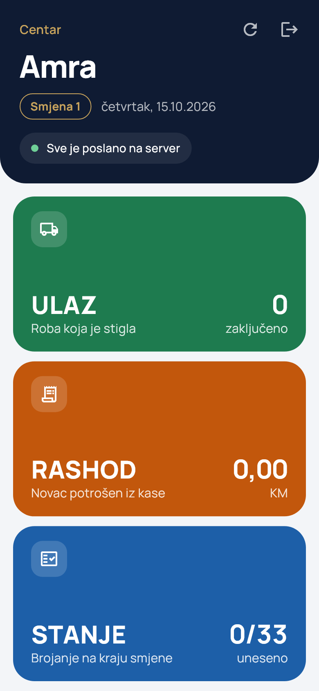 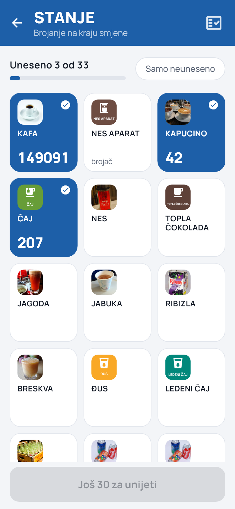 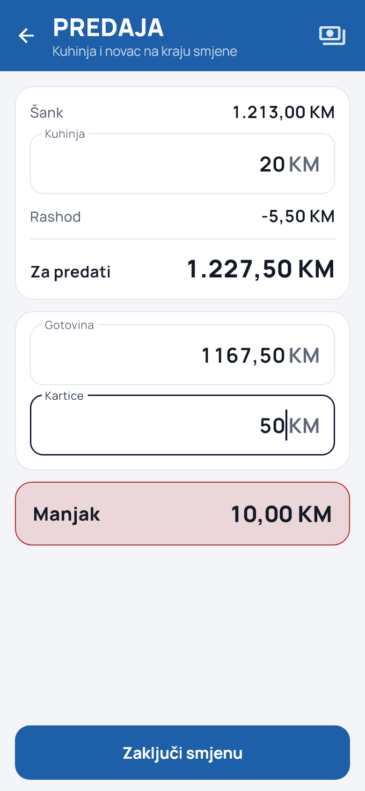

- **Prijava PIN-om.** Svaki konobar ima svoj PIN od 4 cifre, pa se zna ko je radio smjenu.
- **ULAZ:** roba koja je stigla, unosi se dodirom na artikal i brojem.
- **RASHOD:** novac potrošen iz kase (npr. mlijeko iz prodavnice), sa opisom.
- **STANJE:** brojanje na kraju smjene. Artikli su prikazani sa slikama, a aparat za kafu
  vodi se po brojaču.
- **PREDAJA:** konobar upiše iznos kuhinje i koliko predaje u gotovini i karticama.
  Aplikacija odmah pokaže **manjak, višak ili tačno**, prije nego što se smjena zaključi.
- **Upozorenje na grešku u brojanju:** ako je prebrojano više nego što je moglo biti,
  konobar to vidi odmah i može provjeriti.
- **Radi i bez interneta.** Unos se čuva na telefonu i šalje se sam čim se veza vrati.

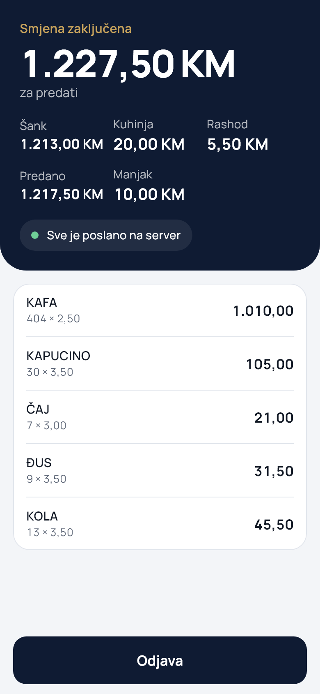

---

## Gazda na telefonu

Ista aplikacija na telefonu pri prvom pokretanju pita ko je koristi. Gazda se prijavi e-mailom i
lozinkom i dobija **sve što ima i na računaru**: obračun, predaju i manjak, izvještaje, narudžbu,
artikle, radnike i obavještenja, prilagođeno ekranu telefona. PDF i Excel se šalju direktno sa
telefona (Viber, WhatsApp, e-mail).

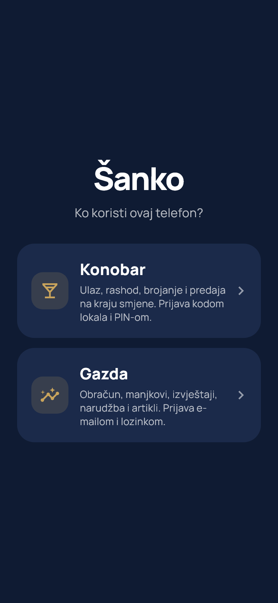 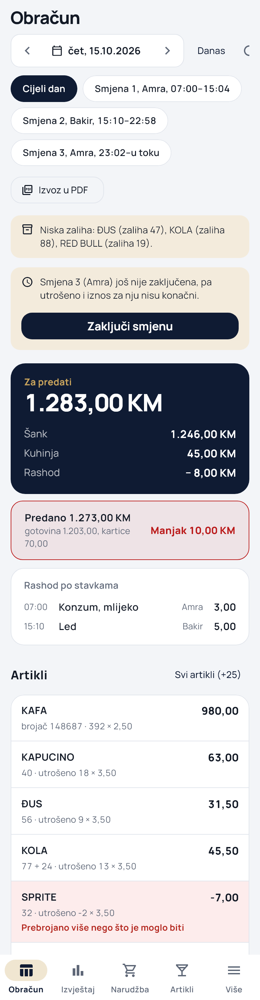 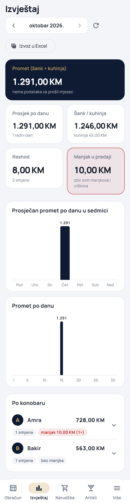

---

## Admin panel za gazdu

### Obračun po danu i smjeni

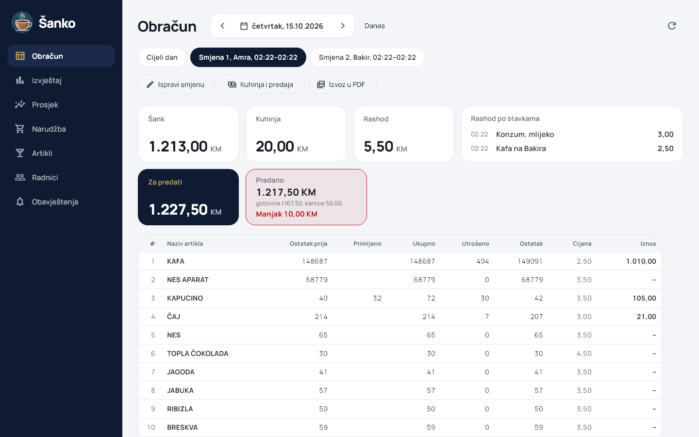

- Tabela kao u knjizi šanka: ostatak prije, primljeno, ukupno, utrošeno, ostatak, cijena i iznos.
- **Šank, kuhinja, rashod i za predati** na jednom mjestu, za cijeli dan ili jednu smjenu.
- **Predano i razlika:** manjak je jasno označen crveno.
- **Ispravke uz zapis:** gazda može ispraviti brojanje, ulaz ili predaju, a svaka promjena
  ostaje zapisana (ko, kada, staro, novo i razlog).
- **Zaključavanje umjesto konobara** ako je otišao bez zaključenja, da sljedeća smjena može početi.
- **Izvoz u PDF** za arhivu ili knjigovođu.
- **Upozorenja:** neuobičajeno velika potrošnja (mnogo veća nego prosjek zadnjih 30 dana) i
  niska zaliha.

### Mjesečni izvještaj i izvještaj po konobaru

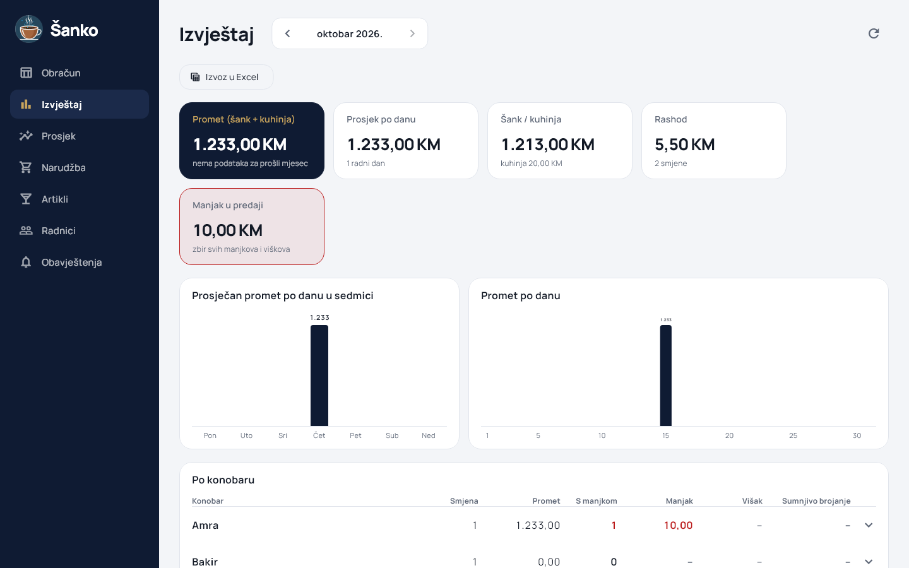

- **Promet mjeseca** (šank + kuhinja) i promjena u procentima prema prošlom mjesecu.
- **Prosjek po danu u sedmici:** koji su dani najjači, za planiranje smjena i nabavke.
- **Promet po danu** kroz cijeli mjesec.
- **Najprodavaniji artikli** sa količinom, prometom i udjelom.
- **Po konobaru:** broj smjena, promet, broj smjena s manjkom, ukupan manjak i višak, i
  sumnjiva brojanja. Klik na konobara otvara listu njegovih smjena. **Odmah se vidi u čijoj
  smjeni nestaje.**
- **Izvoz u Excel** (dani, artikli, konobari) za knjigovođu.

### Narudžba

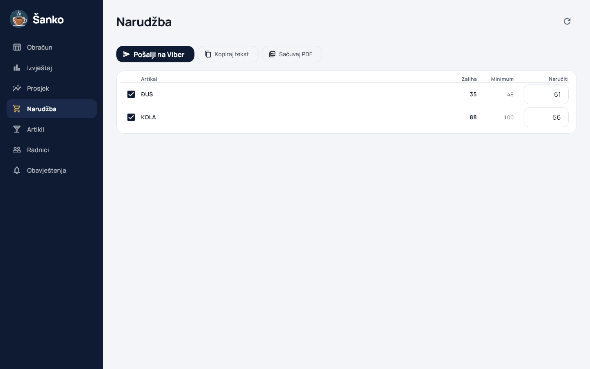

- Za svaki artikal postavite **minimum** i **„naručiti do”**.
- Kad zaliha padne na minimum, artikal se sam pojavi na listi, sa predloženom količinom.
- Artikli bez minimuma se predlažu prema prosječnoj potrošnji.
- **Pošalji na Viber**, kopiraj tekst ili sačuvaj **PDF** za dobavljača.

### Obavještenja na Telegram

Čim se smjena zaključi, na telefon stiže poruka:

```
Korzo: smjena 2 zaključena
Amra, 15.10.2026. 07:00–15:12

Šank: 1.213,00 KM
Kuhinja: 20,00 KM
Rashod: 5,50 KM
Za predati: 1.227,50 KM
Predano: 1.217,50 KM (gotovina 1.167,50 KM, kartice 50,00 KM)
⚠️ MANJAK: 10,00 KM

⚠️ Prebrojano više nego što je moglo biti:
• KOLA: bilo 40, uneseno 42
```

Povezivanje traje jedan klik: u admin panelu **Obavještenja → Poveži Telegram**, pa Start u
Telegramu. Može se povezati više telefona ili grupni razgovor (npr. vlasnik i menadžer).

### Artikli, prosjeci i radnici

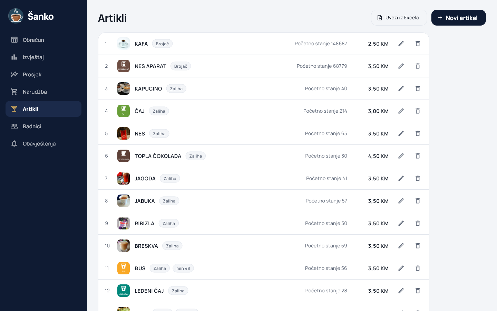

- **Uvoz iz Excela:** postojeća knjiga šanka učita se za minut, sa cijenama i stanjem.
- Slike artikala iz kataloga, da konobar brže nađe artikal.
- **Prosjek:** potrošnja po danu i smjeni, za koliko dana je zaliha dovoljna i neobična brojanja
  u zadnjih 7, 30 ili 90 dana.
- **Radnici:** dodavanje i brisanje konobara i njihovih PIN-ova. Obrisani konobar se odmah
  odjavljuje sa svih telefona.

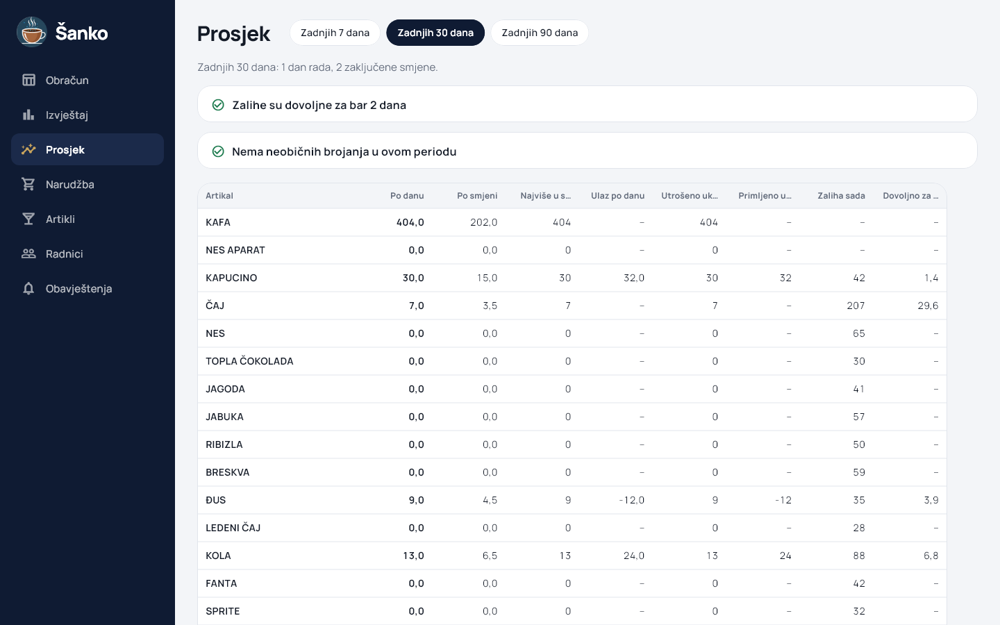

---

## Zašto Šanko

1. **Kontrola gubitaka.** Manjak robe i novca vidi se po smjeni i po konobaru, a ne na kraju
   mjeseca.
2. **Odgovornost.** Svaka smjena ima ime, zaključava se i ne može se naknadno mijenjati bez
   zapisa.
3. **Uvid i kad niste u lokalu.** Poruka na Telegram, a cijeli admin panel i na telefonu.
4. **Ušteda vremena.** Nema više sabiranja u svesci; obračun, izvještaj i narudžba su gotovi
   sami.
5. **Bolja nabavka.** Lista za narudžbu i prosjeci govore šta i koliko naručiti.
6. **Radi bez interneta** na šanku; podaci se šalju čim se veza vrati.
7. **Sigurnost podataka.** PIN-ovi se čuvaju šifrovano, svaki lokal vidi samo svoje podatke, a
   svaka ispravka ostaje zapisana.
8. **Jednostavno uvođenje.** Postojeća Excel tabela se uveze, a konobar nauči aplikaciju za
   15 minuta.

### Primjer računice

> Ako na šanku dnevno „nestane” samo dva piva po 4 KM, to je **240 KM mjesečno**, odnosno
> **2.880 KM godišnje**. Šanko pokazuje gdje i kada nestaje, pa se taj gubitak može zaustaviti.

*(Iznosi su primjer; stvarni gubitak zavisi od lokala.)*

---

## Kako izgleda uvođenje

1. **Pošaljete nam svoju knjigu šanka** (Excel) ili spisak artikala s cijenama.
2. **Mi postavimo lokal:** artikle, slike, konobare i PIN-ove.
3. **Konobari instaliraju aplikaciju** i jednom upišu kod lokala.
4. **Kratka obuka** (oko 15 minuta) i probni period.
5. Po želji povežete **Telegram** za obavještenja.

## Česta pitanja

**Šta ako nestane interneta?**
Konobar nastavlja raditi normalno; sve se čuva na telefonu i šalje kad se veza vrati. Za
početak nove smjene potreban je internet, da dvije smjene ne bi bile otvorene istovremeno.

**Šta ako konobar pogriješi u brojanju?**
Aplikacija upozori na očite greške prije zaključenja. Gazda kasnije može ispraviti brojanje
ili predaju, a ispravka ostaje zapisana.

**Šta ako konobar ode bez zaključenja smjene?**
Gazda je zaključi iz admin panela i upiše stanje i predaju.

**Na kojim uređajima radi?**
Konobar koristi Android telefon. Gazda koristi istu aplikaciju na svom telefonu, ili Windows računar i pregledač; na svim uređajima vidi iste podatke.

**Imam više lokala?**
Jedan nalog gazde može imati više lokala; svaki lokal ima svoje konobare, artikle i obračun.

**Mogu li zadržati svoju Excel tabelu?**
Možete je uvesti u Šanko, a izvještaje u svakom trenutku izvesti nazad u Excel.

---

**Kontakt:** _[ime, telefon, e-mail]_  ·  **Cijena:** _[mjesečna pretplata po lokalu]_
